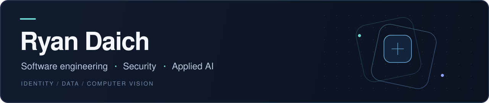

  

[LinkedIn](https://www.linkedin.com/in/ryan-daich/) &nbsp;·&nbsp; [ProcureMate](https://www.procuremateai.com) &nbsp;·&nbsp; [Public projects](#public-projects)

I’m a **software and data engineer** working across identity and access management, applied AI, and computer vision. I work in **Enterprise Cybersecurity at Fidelity Investments** and am **Co-founder & CTO of ProcureMate**.

My work connects data pipelines, product engineering, and security: turning real inputs into useful software, making automated decisions reviewable, and understanding where a system can fail.

## Selected work

### ProcureMate · Computer vision for inventory

Inventory and procurement software that turns camera observations into reviewable stock updates. I work on the product’s software and computer vision capabilities, connecting camera workflows, AI integrations, and the application people use to manage supplies.

**Focus:** camera pipelines, vision-language models, inventory workflows, and human review.

[Product](https://www.procuremateai.com) · [Project overview](https://github.com/Boat1x/Boat1x/blob/main/projects/procuremate.md) &nbsp; / &nbsp; Private source

### Slide · Sports modeling and analytics

A personal project exploring NBA and NHL forecasting through data pipelines, statistical models, and an interactive application. The engineering focus is on forecast uncertainty, reproducible evaluation, and communicating what a model can and cannot support.

**Focus:** Python, statistical simulation, data validation, evaluation, and TypeScript interfaces.

[Project overview](https://github.com/Boat1x/Boat1x/blob/main/projects/slide.md) &nbsp; / &nbsp; Private source · Active development

## Public projects

| Project | What to explore |
| :--- | :--- |
| **[RockSEC](https://github.com/Boat1x/RockSEC)** | An educational cybersecurity consulting prototype. Explore the assessment interface, typed data model, and consultant/admin workflows built with React, TypeScript, and AWS Amplify. |
| **[Personal portfolio](https://github.com/Boat1x/Ryan-Daich-site)** | An earlier website built with HTML, CSS, and JavaScript. A small, inspectable example of responsive layouts, navigation, and interactive UI. |

Each repository’s README explains its implementation, local setup, and current limitations.

## Technical focus

| Area | Experience and tools |
| :--- | :--- |
| **Security & identity** | Identity and access management, access provisioning, security automation, and application access controls |
| **Software & data** | Python, SQL, TypeScript, React, Next.js, PostgreSQL, and API integrations |
| **Applied AI & vision** | AI API integration, vision-language models, Roboflow, model evaluation, and computer vision workflows |
| **Development workflow** | Git, GitHub Actions, automated checks, and AI-assisted development with **ChatGPT**, Claude, and Codex |

## Background

- **Fidelity Investments — Associate Data Engineer, IAM:** Python and SQL work supporting enterprise identity and access management.
- **ProcureMate — Co-founder & CTO:** product development across inventory, procurement, and applied computer vision.
- **New York Life:** internship experience spanning cybersecurity and machine learning, including risk modeling with XGBoost.
- **Manhattanville:** Computer Science with a cybersecurity concentration; minors in Data Science and Communications. Founded the university’s Cybersecurity Club.
- **Certification:** CompTIA Security+.

---

Interested in security engineering, applied AI, and the systems that connect them. [Connect with me on LinkedIn.](https://www.linkedin.com/in/ryan-daich/)
